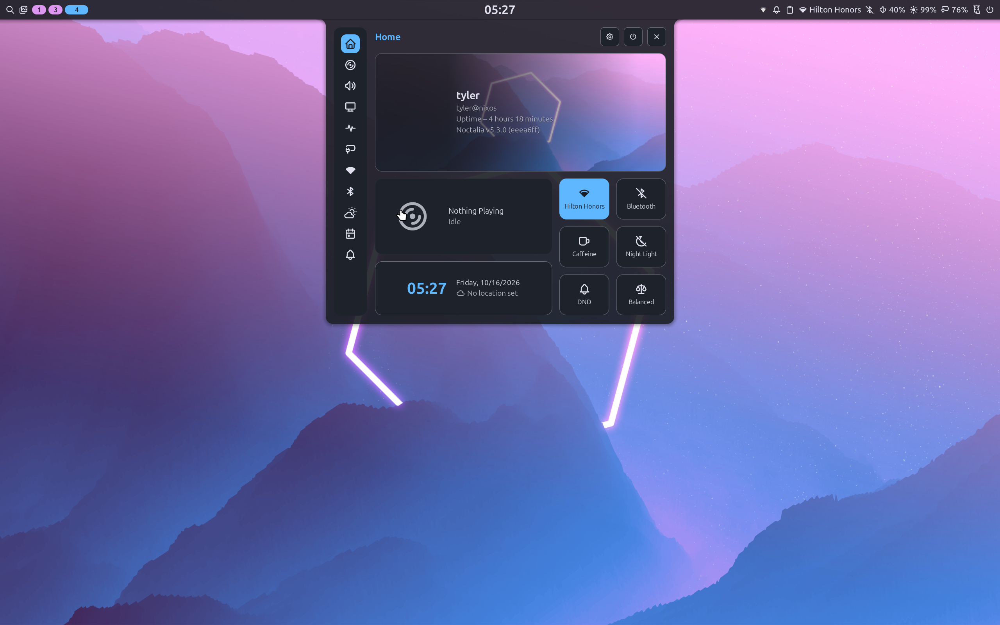
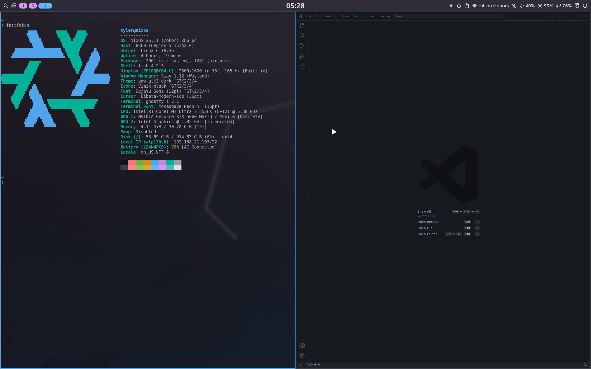
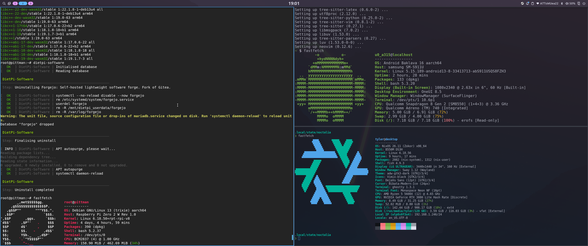

# Nix_Dot_Files

I am likely going to regret this.

## Table of Contents

- [About](./docs/about.md)
- [ToDo](./docs/todo.md)
- [Installation](./docs/installation.md)
- [Sway](./docs/sway.md)
- [Hyprland](./docs/hyprland.md)

---

## Use Case

This repository contains my personal NixOS configuration and dotfiles. The goal is to keep the system declarative, reproducible, modular, and understandable across multiple machines without committing to one editor, shell, or window-management workflow.

> **Warning:** This is a personal work in progress, not a complete or production-ready NixOS distribution. The installation procedure has not been fully tested on a clean machine. Review the configuration before deploying it and adapt the hardware, user, and path-specific settings first.

## Window-manager sessions

Sway is the primary configuration, with Hyprland as an experimental alternative. Both are enabled and can be selected in the greetd/tuigreet session selector. Both sessions are launched inside the systemd user scope named `wayland-session.scope`. Hyprland is configured without UWSM.

Noctalia provides the desktop shell for both sessions. Sway starts Kanshi to apply its host-specific output profile. Hyprland instead applies its host-specific monitor rule from its Home Manager module.

See the separate [Sway documentation](./docs/sway.md) and [Hyprland documentation](./docs/hyprland.md).

## Host-specific display settings

The flake defines three NixOS outputs: `desktop`, `laptop`, and `generic`. I would like to set up `generic` to eventually auto-populate scaling, cursor size, Kanshi, and Noctalia settings based off parsing vga specs in a bash script or user input.

| Host | Output | Sway output scale | Hyprland output scale | Cursor size | Noctalia UI/bar scale |
|---|---|---:|---:|---:|---:|
| `desktop` | LG Ultragear, 3440×1440 at 160 Hz | 1.0 | 1.0 | 24 | 1.25 |
| `laptop` | EDO eDP panel, 2560×1600 at 165 Hz | 1.5 | 1.5 | 30 | 1.5 |
| `generic` | No output assumed | No host profile | No forced monitor rule | 36 | 1.0 |

These are separate controls. Output scaling, pointer-cursor size, Noctalia's shell scaling, and per-application scaling are configured independently. Host settings live under `home-manager/{sway,hyprland,kanshi,noctalia}/`, `home-manager/{host}`, and `hosts/{host}`; application config files live under `home/.config/`. Read the session documentation before changing these values.

## Screenshots





## Repository structure

The tree below shows the main configuration paths rather than enumerating every program module.

```text
Nix_Dot_Files/
├── docs
│   ├── about.md
│   ├── hyprland.md
│   ├── implement.nix
│   ├── installation.md
│   ├── sway.md
│   └── todo.md
├── flake.lock
├── flake.nix
├── .gitignore
├── home
│   └── .config
│       ├── Code
│       │   └── User
│       │       └── settings.json
│       ├── hypr
│       │   └── hyprland.lua
│       ├── noctalia
│       │   ├── hosts
│       │   │   ├── desktop.toml
│       │   │   ├── generic.toml
│       │   │   └── laptop.toml
│       │   └── palettes
│       │       └── AstroDark.json
│       ├── starship.toml
│       ├── stylix
│       │   ├── astrodark_gtk.yaml
│       │   └── backup.yaml
│       └── sway
│           └── config
├── home-manager
│   ├── default.nix
│   ├── hosts
│   │   ├── desktop.nix
│   │   └── laptop.nix
│   ├── hyprland
│   │   ├── desktop.nix
│   │   ├── generic.nix
│   │   ├── hyprland.nix
│   │   └── laptop.nix
│   ├── kanshi
│   │   ├── desktop.nix
│   │   ├── generic.nix
│   │   └── laptop.nix
│   ├── noctalia
│   │   ├── desktop.nix
│   │   ├── generic.nix
│   │   └── laptop.nix
│   ├── programs
│   │   ├── browsers
│   │   │   ├── firefox.nix
│   │   │   ├── qutebrowser.nix
│   │   │   └── vivaldi.nix
│   │   ├── cli
│   │   │   ├── fish.nix
│   │   │   ├── git.nix
│   │   │   ├── starship.nix
│   │   │   └── tmux.nix
│   │   ├── editors
│   │   │   ├── helix.nix
│   │   │   └── vscode.nix
│   │   ├── mime.nix
│   │   ├── misc
│   │   │   ├── obs.nix
│   │   │   ├── ollama.nix
│   │   │   ├── programs.nix
│   │   │   └── unity_hub.nix
│   │   ├── services
│   │   │   └── kanshi.nix
│   │   └── terminals
│   │       └── ghostty.nix
│   ├── stylix
│   │   ├── dconf.nix
│   │   ├── default.nix
│   │   └── include.nix
│   └── sway
│       ├── desktop.nix
│       ├── generic.nix
│       ├── laptop.nix
│       └── sway.nix
├── hosts
│   ├── desktop
│   │   ├── default.nix
│   │   └── hardware-configuration.nix
│   ├── generic
│   │   ├── default.nix
│   │   └── hardware-configuration.nix
│   └── laptop
│       ├── default.nix
│       └── hardware-configuration.nix
├── LICENSE
├── modules
│   ├── audio
│   │   └── audio.nix
│   ├── de
│   │   ├── hyprland.nix
│   │   └── sway.nix
│   ├── default.nix
│   ├── dm
│   │   └── tuigreet.nix
│   ├── graphics
│   │   └── nvidia.nix
│   ├── packages
│   │   ├── gaming.nix
│   │   └── packages.nix
│   ├── system
│   │   ├── boot.nix
│   │   ├── fonts.nix
│   │   ├── locale.nix
│   │   ├── networking.nix
│   │   ├── security.nix
│   │   ├── session.nix
│   │   └── system.nix
│   └── users
│       └── tyler.nix
├── README.md
├── reference
│   ├── astrodark.lua
│   └── Hilltopper.png
├── scripts
│   ├── gen.sh
│   ├── rebuild.sh
│   ├── security_check.sh
│   ├── trash.sh
│   ├── tree.sh
│   └── upgrade.sh
├── scrot1.png
├── scrot2.png
├── scrot3.png
└── .vscode
    └── tasks.json

41 directories, 91 files
```

## Separation of responsibilities

| Location | Purpose |
|---|---|
| `hosts/` | Machine-specific hostname, hardware configuration, and host imports |
| `modules/` | Reusable, system-wide NixOS configuration |
| `home-manager/` | User applications, per-host desktop settings, and integration |
| `home/.config/` | The application configuration files consumed by Home Manager |
| `scripts/` | Rebuild, upgrade, cleanup, and helper scripts |
| `docs/` | Installation and project documentation |
| `reference/` | Theme references and assets |

The flake imports the shared modules and then the selected host's hardware and Home Manager settings. Most application preferences are kept in normal configuration files and pointed to by Home Manager rather than rewritten as Nix expressions.

## Notable dependencies

| Dependency | Purpose |
|---|---|
| NixOS flakes / nixpkgs unstable | System configuration and package source |
| Home Manager | Declarative user environment |
| Stylix | GTK theming and shared palette integration |
| Sway | Primary Wayland compositor |
| Hyprland | Experimental alternative compositor; UWSM is disabled |
| Noctalia | Desktop shell, bar, launcher, notifications, lock screen, and controls |
| Kanshi | Host-specific output profiles for Sway |
| greetd / tuigreet | TTY-based login and session selection |
| Alejandra | Nix formatter |

NixOS owns core services, hardware, system packages, users, security, and the Wayland session infrastructure. Home Manager owns most applications and user-level configuration. Both NixOS and Home Manager state versions are set in the configuration; do not change them merely to update packages.

## Hardware support

This is a personal configuration that has been used with NVIDIA graphics and AMD Ryzen / Intel CPUs. Host hardware files are under `hosts/`, and NVIDIA support is configured in `modules/graphics/nvidia.nix`. AMD GPU support has not been tested with this setup. Always inspect the generated hardware configuration and output names before applying it to another machine.

## Credits

### Visual inspiration

- [Positron Dream](https://www.positrondream.com/about)
- [Madison's Reddit](https://www.reddit.com/user/Madisor_)

### Color scheme

- [AstroNvim's Astrodark](https://astronvim.com/)
